# Windows Server 2022 Lab: AD, Group Policy, Hyper-V Clustering, RDS and PKI

A one-week build of a small enterprise Windows environment on nested Hyper-V in Azure: two domain controllers, a two-node failover cluster on iSCSI storage, an internal certificate authority, Remote Desktop Services, a Windows 11 client and a Rocky Linux server.

The build was the easy part. Most of what I learned came from things breaking, so this write-up is mostly about those: what I saw, what caused it, how I fixed it, and what I'd do differently.

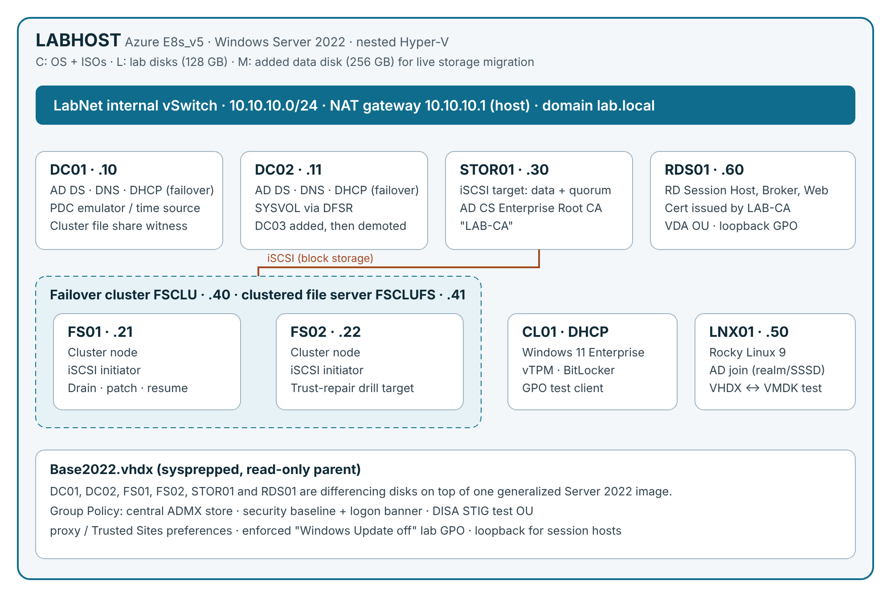

---

## Contents

- [Environment](#environment)
- [What I built](#what-i-built)
- [What broke and how I fixed it](#what-broke-and-how-i-fixed-it)
- [Commands I'll keep using](#commands-ill-keep-using)
- [Terms I learned](#terms-i-learned)
- [What I'd do differently](#what-id-do-differently)

---

## Environment

| VM | IP | Role |
|---|---|---|
| **LABHOST** | Azure | Azure E8s_v5 VM running Windows Server 2022 with nested Hyper-V. Internal vSwitch + NAT. |
| **DC01** | 10.10.10.10 | Domain controller, DNS, DHCP (failover pair), PDC emulator / time source, cluster file share witness |
| **DC02** | 10.10.10.11 | Domain controller, DNS, DHCP (failover pair) |
| **STOR01** | 10.10.10.30 | iSCSI target (data + quorum disks), AD CS Enterprise Root CA |
| **FS01 / FS02** | .21 / .22 | Failover cluster nodes (cluster FSCLU .40, clustered file server FSCLUFS .41) |
| **RDS01** | 10.10.10.60 | RD Session Host, Connection Broker, RD Web Access |
| **CL01** | DHCP | Windows 11 Enterprise client with a virtual TPM |
| **LNX01** | 10.10.10.50 | Rocky Linux 9 |

Domain: `lab.local`. Every Windows server is a differencing disk on one sysprepped, read-only Server 2022 base image.

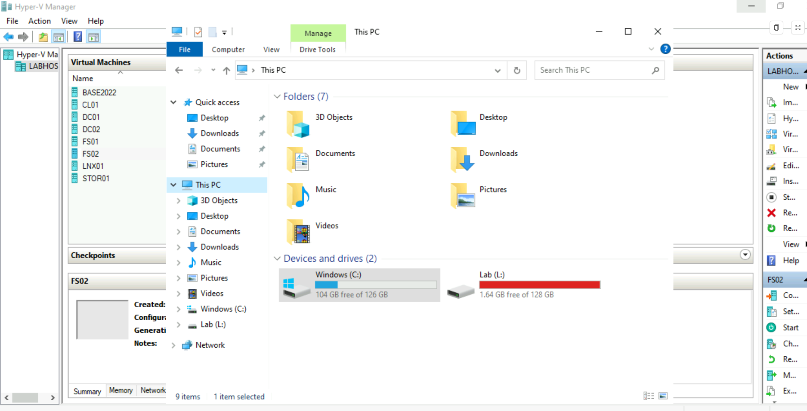

---

## What I built

**Hyper-V and the host**
- Nested virtualization on an Azure VM (Standard security type, since Trusted Launch blocks nested Hyper-V)
- Internal vSwitch with NAT so the lab's DHCP can't leak onto any real network
- Sysprepped base image + differencing disks, Gen 2 VMs, virtual TPM for Windows 11, Secure Boot template for Linux
- Checkpoints, live storage migration (`Move-VMStorage`), VHDX compaction, VHDX → VMDK conversion with qemu-img

**Active Directory, DNS, DHCP**
- New forest, second DC, FSMO transfer, reverse zone, SRV record checks, scavenging
- DHCP failover between both DCs
- OU structure (Users, Workstations, Servers, Groups, VDA) and bulk user creation from CSV
- Replaced a DC: promoted DC03, moved the FSMO roles, demoted it
- AD-integrated time hierarchy: PDC emulator as the source, Hyper-V time sync turned off for DCs

**Group Policy**
- Central ADMX store, security baseline with logon banner, remote-update firewall rules
- Pushed GPOs three ways (`gpupdate`, `Invoke-GPUpdate`, GPMC by OU) and proved them with `gpresult`
- Broke it on purpose and fixed it: wrong OU link, security filtering without Authenticated Users read, WMI filter, loopback, client DNS, clock skew, SYSVOL replication, group membership needing a new logon
- Group Policy Preferences for proxy bypass / Trusted Sites
- DISA STIG GPO backups imported into a test OU
- Enforced domain-level GPO to stop Windows Update in the lab (see incident 1)

**Clustering and storage**
- iSCSI target on STOR01, initiators on FS01/FS02
- `Test-Cluster` validation, two-node cluster, disk witness then file share witness
- Clustered file server role and planned/unplanned failover

**Remote access and PKI**
- RDS quick deployment on RDS01 (session host, broker, web access)
- Enterprise Root CA on STOR01, certificate templates, enrollment permissions, cert bound to the RDS roles

**Linux**
- Rocky Linux 9 on Hyper-V, `/etc/fstab` recovery from emergency mode, rebuild when locked out

---

## What broke and how I fixed it

### 1. Host disk filled up and took the domain down with it

This one chained through five layers before I found the cause.

| Symptom | What was actually happening |
|---|---|
| VMs showing **Paused-Critical**, later both DCs: "Disk(s) encountered critical IO errors" | The L: volume on the host hit 0 bytes free. Dynamic VHDX files can't grow, so Hyper-V pauses the VM to protect it. |
| Member servers on the **Private** firewall profile | With the DCs paused, Network Location Awareness couldn't find a DC, so the profile dropped from DomainAuthenticated to Private. |
| `Test-Cluster`: "Unable to connect via WMI. The RPC server is unavailable." | The Private profile blocks RPC/WMI from other machines. |
| `gpupdate`: "failed because of lack of network connectivity to a domain controller" | Same root cause: no reachable DC. |
| FS02: "The trust relationship between this workstation and the primary domain failed" | FS02 rotated its machine password with one DC while the other was paused, before replication caught up. |

**Root cause:** the VMs were pulling Windows Updates through the NAT and the dynamic disks ballooned (FS02 went from 7 GB to 22 GB in an afternoon; DC01 from 16 GB to 38 GB).

**Fix:**
1. Added a 256 GB Azure data disk (attaches live) and moved the busiest VMs to it with `Move-VMStorage` while they ran.
2. Resumed the paused VMs, then checked DFSR for event 2213 (dirty shutdown) on the DCs.
3. Wrote a script that shuts each VM down cleanly, mounts its VHDX on the host, deletes the update caches from outside the guest, compacts the disk with `Optimize-VHD`, and starts it again. Stopping `wuauserv` inside a guest mid-install just hangs.
4. Linked a "Windows Update off" GPO at the domain root with **Enforced**, so OU-linked WSUS GPOs can't override it.
5. Restarted the NIC on the DCs and members so they re-detected the domain network, repaired FS02's secure channel, and forced replication.

**Lesson:** check the basics first. A full disk showed up as a firewall problem, a Group Policy problem, a cluster problem and a trust problem.

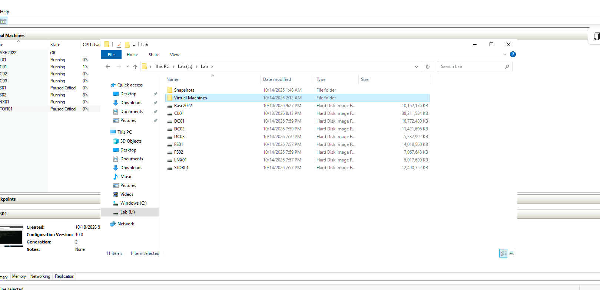
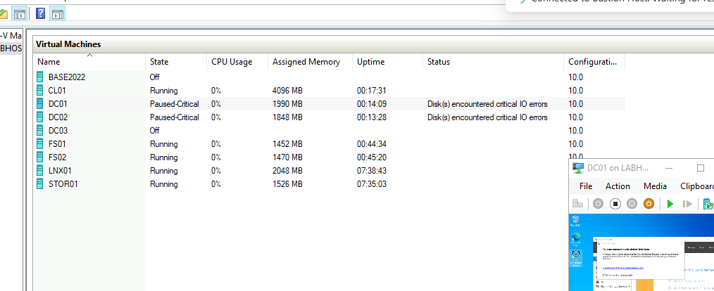
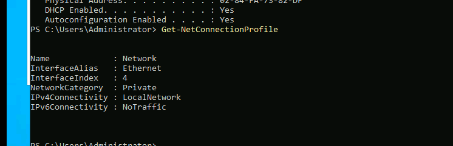
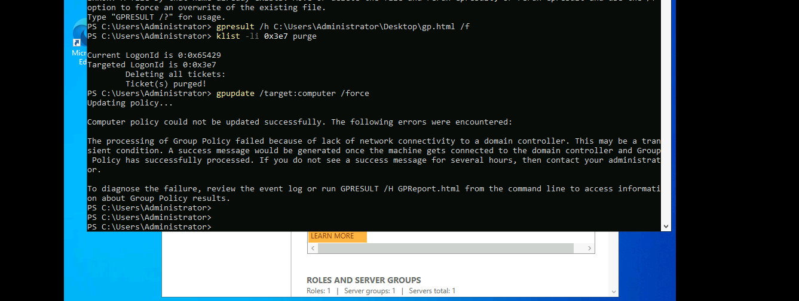
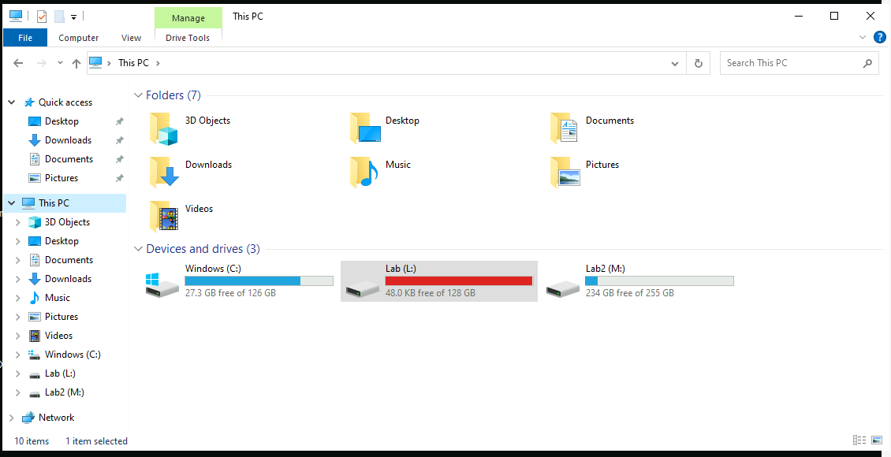

### 2. Broken trust relationship

**Symptom:** domain logons on FS02 failed with the trust relationship error.
**Cause:** FS02's machine account password no longer matched what AD had. I caused it on purpose once by restoring an old checkpoint; it also happened for real after the DC outage above.
**Fix:** signed in with the local admin (or used PowerShell Direct from the host), ran `Test-ComputerSecureChannel -Server DC01` and `-Server DC02` to see which DC disagreed, then `Test-ComputerSecureChannel -Repair -Credential LAB\Administrator`, then `repadmin /syncall /AdeP`.
**Side lesson:** `Remove-ADComputer` fails with "can perform the requested operation only on a leaf object" when the computer object has child objects; `Remove-ADObject -Recursive` handles it.

### 3. SYSVOL non-authoritative restore and time source

Practiced a non-authoritative SYSVOL resync on DC02: set `msDFSR-Enabled` to FALSE in ADSI Edit, replicated, confirmed event 4114, re-enabled, confirmed 4614/4604. Same session, `w32tm /query /source` showed **Local CMOS Clock** on a DC, which means it wasn't syncing from anything. Fixed with `w32tm /config /syncfromflags:domhier /update` and turned off Hyper-V time sync for the DCs.

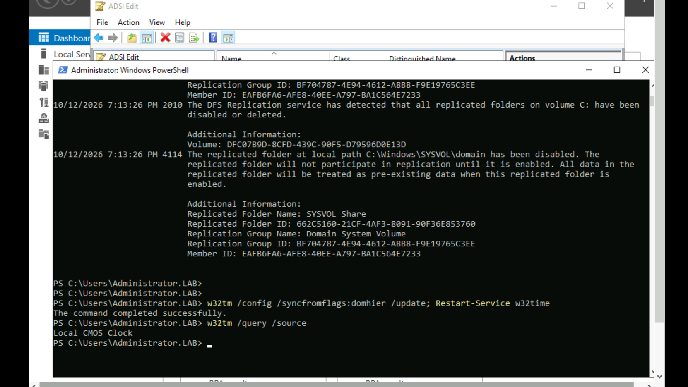

### 4. DC demote blocked by my own password policy

`Uninstall-ADDSDomainController` failed because the new local administrator password didn't meet the 14-character minimum I had set in the domain password policy earlier in the week. It made sense once I read it: the demoted server falls back to local accounts, and the policy still applies.

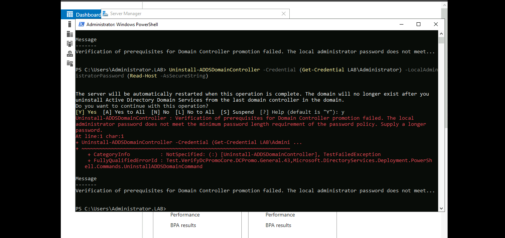

### 5. Clustering: four separate blockers

| Error | Cause | Fix |
|---|---|---|
| `Test-Cluster`: Access is denied | Signed in as the local Administrator, which has no rights on the other node or in AD | Signed in as the domain admin |
| Unable to connect via WMI / RPC unavailable | FS02 on the Private firewall profile and still on DHCP | Static IP, DNS pointed at the DCs, NIC restart to re-detect the domain |
| "File Services could not be found on any node" | `FS-FileServer` wasn't installed on the nodes | `Install-WindowsFeature FS-FileServer` on both nodes |
| File share witness | The cluster writes to the witness as its own computer account (FSCLU$) | Granted FSCLU$ on both the share and NTFS; the cluster created its GUID folder in the share |

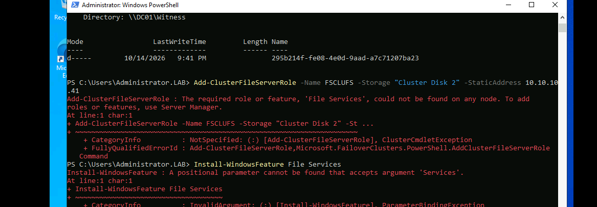

### 6. RDS and an internal CA: one error at a time

| Error | Cause | Fix |
|---|---|---|
| `ERR_SSL_KEY_USAGE_INCOMPATIBLE` on RD Web | The cert RDS generated for itself didn't allow digital signature, and current browsers require it | Issue a proper Web Server cert from an internal CA |
| CA install: `ERROR_DS_RANGE_CONSTRAINT` | Installed as the local admin. An Enterprise CA writes to AD's configuration partition, which needs Enterprise Admins. | Re-ran as the domain admin |
| "The requested certificate template is not supported by this CA" | The template wasn't published on the CA | Published it with `Add-CATemplate`, replicated |
| "You do not have permission to request this type of certificate" | A LocalMachine request enrolls as the **computer** account, not the user | Gave the computer account Read + Enroll on the template |
| "Cannot export non-exportable private key" | The built-in Web Server template is a v1 template with a locked key, and RDS wants an exportable one | Duplicated the template with "Allow private key to be exported" |

Also learned not to trust a command that returns nothing: `Set-RDCertificate -Thumbprint` returned no error, but `Get-RDCertificate` still showed every role as NotConfigured.

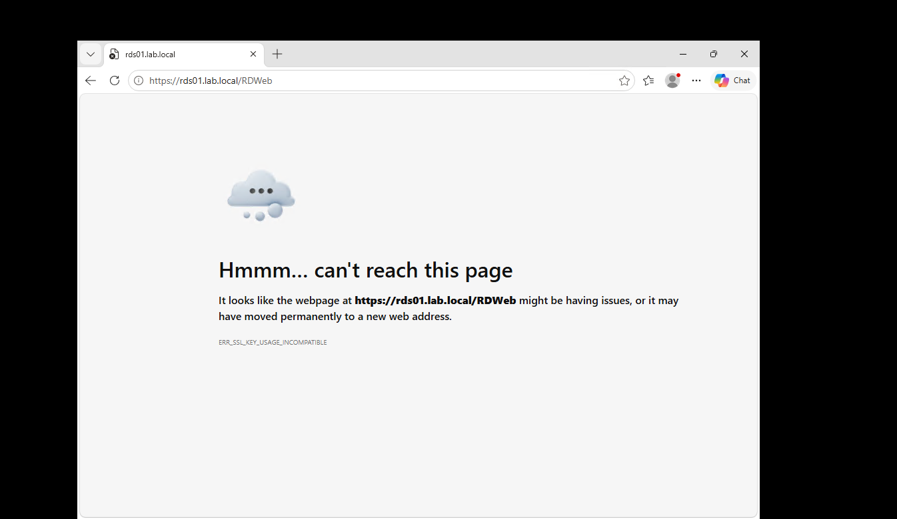
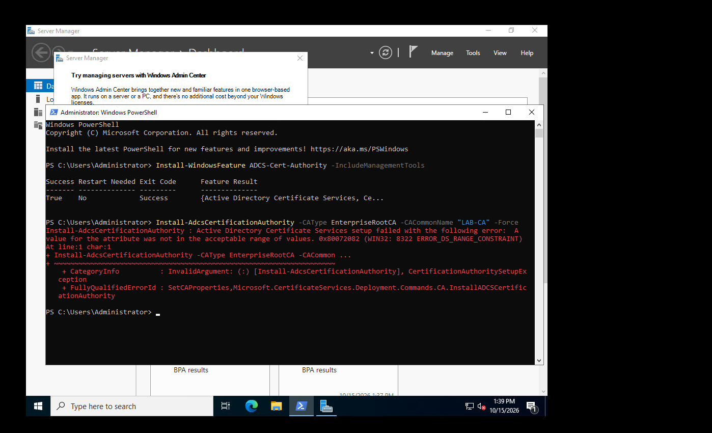
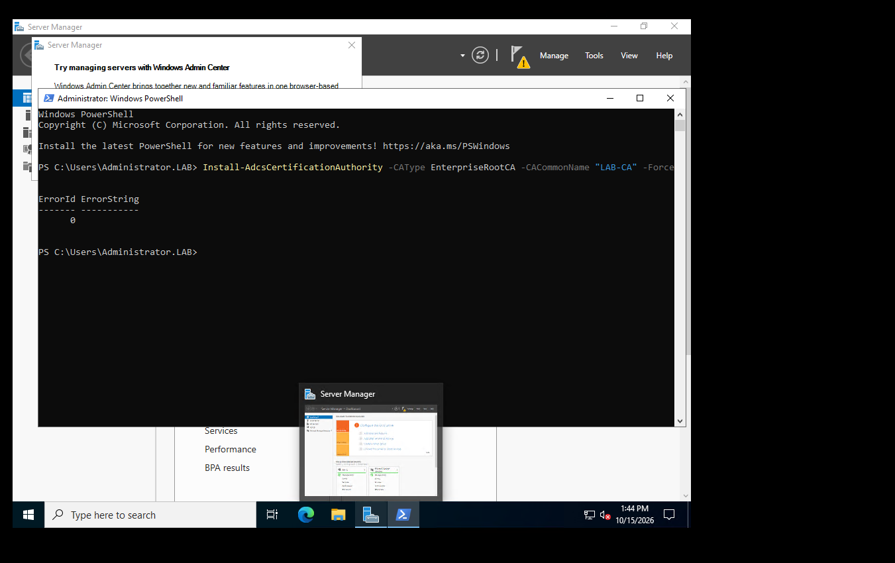
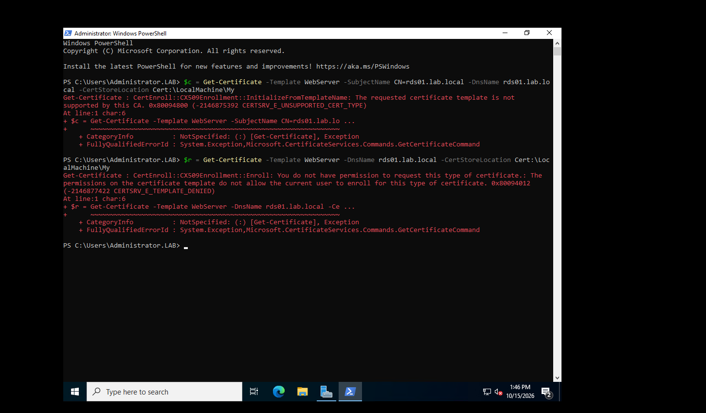
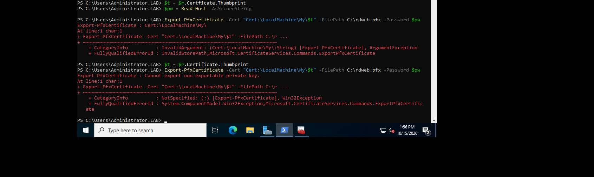
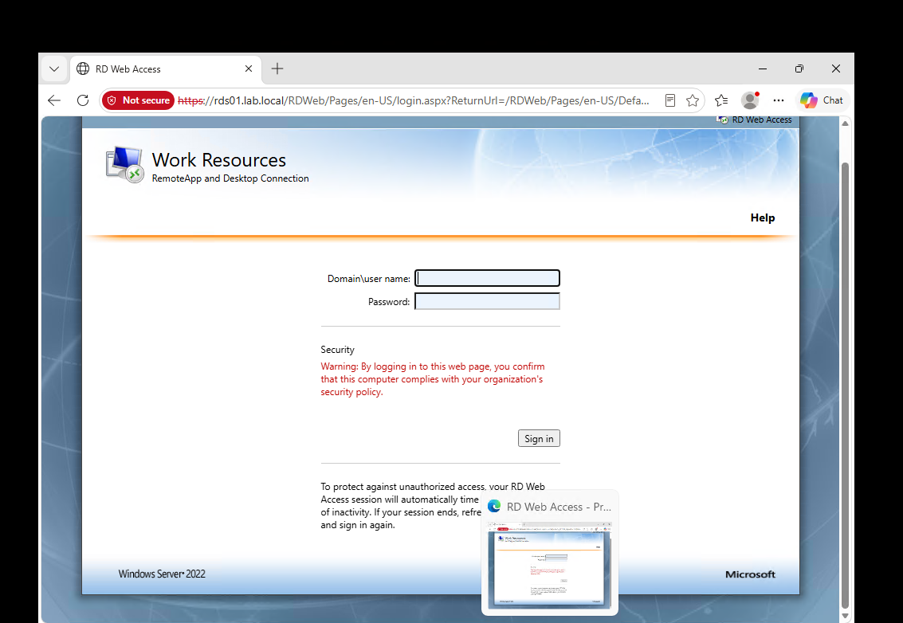

### 7. Windows 11 VM wouldn't restore from saved state

**Error:** "Microsoft Virtual TPM Device ... Failed to restore with Error 'The computed authentication tag did not match the input authentication tag.'"
**Cause:** the saved state, which includes the vTPM's encrypted data, was damaged when the host volume filled.
**Fix path:** `Remove-VMSavedState` and cold boot. If the vTPM itself can't be unlocked: reset it (`Disable-VMTPM`, new key protector, `Enable-VMTPM`), get the BitLocker recovery password from AD (`msFVE-RecoveryInformation` under the computer object), then reseal BitLocker to the new TPM with `manage-bde -protectors -add C: -tpm`.

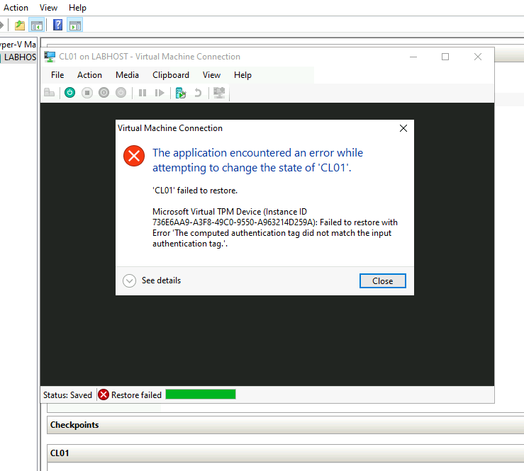

### 8. Smaller ones worth remembering

- **STIG GPO import:** `Import-GPO -Path` wants the folder that *contains* the `{GUID}` backup folders, not the GUID folder itself. Reading each `bkupInfo.xml` gives the GPO name and backup ID.
- **"Not recognized as a cmdlet" on a command I knew was right:** hidden characters from pasting. Retyping it fixed it.
- **A typo PowerShell doesn't flag:** `$r.Certficate.Thumbprint` returns nothing instead of an error. Tab completion prevents it.
- **qemu-img `SetEndOfFile error 112`:** Windows error 112 is "not enough space on the disk". Same root cause as incident 1.
- **`New-VM` disk-full error with the VHD on another drive:** the VM's config files still go to the default path unless you pass `-Path`.

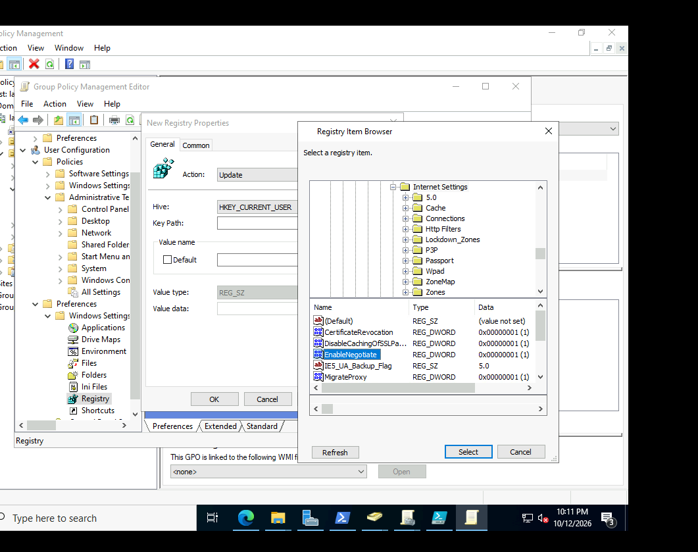

---

## Commands I'll keep using

```powershell
# Replication and Group Policy
repadmin /syncall /AdeP                      # push AD changes to every DC now
repadmin /replsummary                        # replication health at a glance
Invoke-GPUpdate -Computer CL01 -Force -RandomDelayInMinutes 0   # remote gpupdate, no 10-minute random delay
gpresult /r /scope computer                  # which GPOs applied, and from which OU
klist -li 0x3e7 purge                        # clear the computer's Kerberos tickets before a refresh

# Trust, time, DC location
Test-ComputerSecureChannel -Repair -Credential LAB\Administrator
nltest /dsgetdc:lab.local
w32tm /query /source

# Network location (domain vs private profile)
Get-NetConnectionProfile
Restart-NetAdapter -Name Ethernet

# Hyper-V
Get-VM | ? State -like 'Paused*' | Resume-VM
Move-VMStorage -VMName FS02 -DestinationStoragePath M:\Lab\FS02
Invoke-Command -VMName FS02 -Credential LAB\Administrator { ... }   # PowerShell Direct, works with no network

# Certificates and RDS
certutil -ADCA
Add-CATemplate -Name WebServer -Force
Get-RDCertificate -ConnectionBroker rds01.lab.local
```

---

## Terms I learned

| Term | What it means |
|---|---|
| **Paused-Critical** | Hyper-V paused a VM because its storage can't take writes, usually a full host volume |
| **Network Location Awareness (NLA)** | The Windows service that decides whether a NIC is on a Domain, Private or Public network, which decides the firewall profile |
| **Secure channel** | The trust between a domain member and AD, based on the computer account's password |
| **FSMO roles** | Five single-holder AD roles; the PDC emulator is the time source and handles password changes and lockouts |
| **Non-authoritative restore** | One DC throws away its copy and pulls a fresh one from a partner (DFSR events 4114 → 4614 → 4604) |
| **Quorum / witness** | The tie-breaker vote that stops a split cluster from running on both halves |
| **CNO** | Cluster Name Object, the cluster's computer account in AD (FSCLU$) |
| **SAN vs NAS** | SAN presents a disk (iSCSI, Fibre Channel) that the server formats; NAS presents a share (SMB, NFS) |
| **Key Usage** | The certificate field that lists what the key is allowed to do; browsers require digital signature for TLS |
| **Template publishing** | A CA only issues templates that are on its list (`Add-CATemplate`) |
| **v1 template** | Built-in templates like Web Server whose settings can't be edited, only duplicated |
| **Enforced GPO link** | A link that can't be overridden by GPOs linked lower down (LSDOU: Local, Site, Domain, OU) |
| **PowerShell Direct** | Running commands in a VM through Hyper-V itself, no network needed |
| **Differencing disk** | A child VHDX that stores only changes from a read-only parent |

---

## What I'd do differently

1. **Size storage for growth, and alert on it.** Dynamic disks plus Windows Update filled a 128 GB volume in a day. Next time: separate data disk from the start, and a free-space check before every session.
2. **Control updates on day one.** A lab with internet access patches itself. WSUS or a policy GPO should be in place before the first VM boots.
3. **Static IPs and DC-only DNS for every server.** One server left on DHCP cost an hour.
4. **Never work as the local Administrator on a domain member.** Three different failures this week (cluster validation, CA install, AD queries) came down to that.
5. **Verify after every "success".** No output isn't the same as it worked.

---

*Lab only: evaluation licenses, no production data.*
