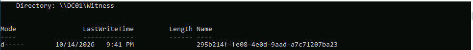
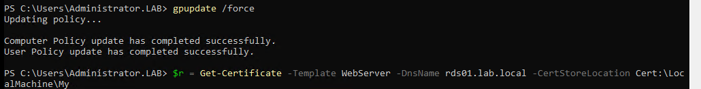

# Windows Server Lab

Windows Server 2022 environment built on nested Hyper-V in Azure: Active Directory, Group Policy, a two-node failover cluster on iSCSI storage, an internal certificate authority, Remote Desktop Services, a Windows 11 client and a Rocky Linux server joined to the domain.

I built it to get hands-on with the infrastructure I want to run day to day. The parts I cared most about were clustering and shared storage. Most production Windows workloads sit on Hyper-V clusters backed by a SAN, and the hard parts of that job are keeping VMs up while hosts get patched, understanding why a cluster loses quorum, and knowing how block storage behaves when a node drops. iSCSI let me build that same pattern with nothing but VMs.

This is a living project. I'm adding to it (see [Roadmap](#roadmap)).


## Environment

| VM | IP | Role |
|---|---|---|
| LABHOST | Azure | E8s_v5, Windows Server 2022, nested Hyper-V, internal vSwitch with NAT |
| DC01 | 10.10.10.10 | Domain controller, DNS, DHCP failover partner, PDC emulator and time source, cluster file share witness |
| DC02 | 10.10.10.11 | Domain controller, DNS, DHCP failover partner |
| STOR01 | 10.10.10.30 | iSCSI target (data and quorum disks), Enterprise Root CA |
| FS01, FS02 | .21, .22 | Failover cluster nodes. Cluster FSCLU (.40), clustered file server FSCLUFS (.41) |
| RDS01 | 10.10.10.60 | RD Session Host, Connection Broker, RD Web Access |
| CL01 | DHCP | Windows 11 Enterprise with a virtual TPM |
| LNX01 | 10.10.10.50 | Rocky Linux 9, joined to the domain |

Domain `lab.local`. Every Windows server runs on a differencing disk off one sysprepped, read-only Server 2022 base image.


## What I built

**Hyper-V**
- Nested virtualization on an Azure VM, internal vSwitch with NAT so lab DHCP stays isolated
- Sysprepped base image with differencing disks, Gen 2 VMs, virtual TPM, Linux Secure Boot template
- Checkpoints, live storage migration with `Move-VMStorage`, VHDX compaction with `Optimize-VHD`
- VMware to Hyper-V disk conversion: converted a VHDX to VMDK and back with **qemu-img**, then built a VM from the converted disk. In production I'd reach for StarWind V2V Converter or a Veeam restore straight to Hyper-V, and plan for the post-conversion work: remove VMware Tools, match Gen 1 vs Gen 2 to the source firmware (BIOS VMs become Gen 1), re-IP the NIC, check activation.

**Active Directory**
- New forest, second DC, DNS reverse zone and SRV record checks, scavenging, DHCP failover across both DCs
- **FSMO (Flexible Single Master Operations)** roles: transferred between DCs, and know when to seize instead
- DC replacement: promoted DC03, moved the FSMO roles, demoted it, checked functional level
- OU design (Users, Workstations, Servers, Groups, VDA) and bulk user creation from CSV
- AD Recycle Bin, fine-grained password policy, BitLocker recovery keys escrowed to AD

**Group Policy**
- Central ADMX store, security baseline with logon banner, firewall rules for remote GP refresh
- Pushed policy three ways (`gpupdate`, `Invoke-GPUpdate`, GPMC by OU) and verified with `gpresult`
- Troubleshot the common failures on purpose: wrong OU link, security filtering without Authenticated Users read, WMI filters, loopback processing, client DNS, clock skew, SYSVOL replication, group membership needing a new logon
- Group Policy Preferences for proxy bypass and Trusted Sites
- DISA STIG GPO backups imported into a test OU before wider rollout


**Clustering and storage**
- iSCSI target on STOR01, initiators on both nodes, `Test-Cluster` validation
- Two-node cluster, disk witness and then a file share witness on DC01 (granted to the cluster's computer account, FSCLU$)
- Clustered file server role, planned and unplanned failover, drain / patch / resume of a node



**Why iSCSI.** A failover cluster needs storage that every node can see, so whichever node owns the file server role can mount the disk and the other can take it over. In an organization that's a SAN (Dell, NetApp, Pure) wired to the Hyper-V or VMware hosts over Fibre Channel or iSCSI. iSCSI carries SCSI disk commands over ordinary Ethernet, so STOR01 plays the SAN here and FS01/FS02 see its disks as local, unformatted drives. In production the same setup gets dedicated storage NICs on their own VLAN, MPIO (two paths so one dead switch doesn't drop the disk) and CHAP authentication. In a home lab, iSCSI is the only free way to practice shared-storage clustering without buying a SAN.

**Why a quorum witness.** Each node gets a vote, and the cluster only runs while more than half the votes are online. With two nodes, losing one leaves 1 of 2, which isn't a majority, so the witness is the third vote that breaks the tie. Its real job is preventing split-brain: if the nodes lose sight of each other, only the side that holds the witness keeps running, so both nodes never write to the same disk at once and corrupt it. I tried both a disk witness (a small iSCSI LUN) and a file share witness. Picking the witness type matters on a disconnected network: Azure cloud witness is the default suggestion in newer builds and won't work with no internet, so it's a file share or disk witness there. The witness also shouldn't live on a VM that runs on the same cluster it's protecting.

**Remote access and PKI**
- RDS session deployment on RDS01
- Enterprise Root CA on STOR01, Web Server certificates issued to RDS (details below)

**Linux**
- Rocky Linux 9 joined to AD with realmd and SSSD, domain logins, sudo granted through an AD group

```bash
dnf install -y realmd sssd oddjob oddjob-mkhomedir adcli samba-common-tools krb5-workstation
realm discover lab.local
realm join lab.local -U Administrator
id user1@lab.local
realm permit -g LinuxAdmins@lab.local
echo '%linuxadmins@lab.local ALL=(ALL) ALL' > /etc/sudoers.d/linuxadmins
```

## Incident: host storage ran out and took the domain with it

**What happened.** The host volume holding the VM disks filled up. Hyper-V put the affected VMs, including both domain controllers, into **Paused-Critical** ("disks encountered critical IO errors"). From there it cascaded: clients couldn't reach a DC, Group Policy failed with "lack of network connectivity to a domain controller", cluster validation failed with "RPC server unavailable", and one server lost its trust relationship after rotating its machine password with one DC while the other was paused.

**Root cause.** The VMs reached the internet through NAT and were downloading and installing Windows Updates. The dynamic disks grew fast: one file server went from 7 GB to 22 GB in an afternoon, and DC01 from 16 GB to 38 GB.

**Fix.**
1. Attached a 256 GB Azure data disk and moved the busiest VMs onto it with `Move-VMStorage` while they ran.
2. Resumed the paused VMs, then **restarted both domain controllers cleanly**. After being paused mid-write, AD Web Services stopped answering and the DCs weren't serving clients reliably until they came back up fresh. After the restart I checked the DFS Replication log for event 2213 (dirty shutdown, which pauses SYSVOL replication until resumed by hand) and forced replication with `repadmin /syncall /AdeP`.
3. **Disabled Windows Update in the lab**: an enforced GPO at the domain root (Configure Automatic Updates = Disabled), and the `wuauserv` service set to Disabled. Enforced so no OU-level update policy could override it.
4. Reclaimed space offline: shut each VM down, mounted its VHDX on the host, cleared the update caches, compacted the disk with `Optimize-VHD`, and started it again.
5. Repaired the broken secure channel (next section).

**How updates should be served instead.** Clients shouldn't pull from the internet on their own. On an internal or disconnected network the standard is **WSUS** (or MECM with WSUS as its software update point): one server syncs updates, admins approve them, and clients get them by GPO in rings (test, production servers, DCs one at a time, clusters node by node). On a fully disconnected network, WSUS syncs on a connected system and the content is exported and imported across. Microsoft has stopped adding features to WSUS but it is still supported and shipped. Internet-connected fleets are moving to Windows Update for Business, Autopatch or Azure Update Manager.


## Trust relationships: `nltest` and `Test-ComputerSecureChannel`

Every domain member has a computer account with a password that the machine rotates on its own. If the machine and AD disagree on that password, the secure channel breaks and domain logons fail with "the trust relationship between this workstation and the primary domain failed."

Two commands make this quick to diagnose:

- **`nltest /dsgetdc:lab.local`** shows which DC the machine is actually talking to and whether it can find one at all. It's the first check for any "can't log in / GPO won't apply" ticket, because it separates "can't find a DC" (DNS, network, site config) from "found a DC but it's rejecting me".
- **`Test-ComputerSecureChannel`** returns True or False for the trust itself. Running it with `-Server DC01` and `-Server DC02` shows whether the DCs disagree, which points to replication lag rather than a truly broken account. `-Repair -Credential` resets the password with a DC and fixes it without unjoining and rejoining, so the machine keeps its SID, group memberships and GPO scope.

## When DC01 goes down

DC01 was the first DC in the forest, so it holds all five FSMO roles. **FSMO roles do not fail over on their own.** DC02 keeps the domain running, but it does not take the roles unless someone moves them.

What keeps working with only DC02 up: logons and Kerberos, LDAP, AD-integrated DNS (as long as clients list DC02 as a DNS server), global catalog lookups, and DHCP through the failover partnership.

What degrades, by role:

| Role | Impact while DC01 is down |
|---|---|
| PDC emulator | No authoritative time source, so clock skew creeps in over days. Password changes and lockouts no longer funnel to one DC. GPMC edits GPOs on the PDC by default and warns. |
| RID master | DC02 keeps creating users and computers until its current RID pool (500 IDs) runs out, then new accounts fail. |
| Infrastructure master | No impact when every DC is a global catalog, as here. |
| Schema master, Domain naming master | Only needed for schema extensions and adding or removing domains. |

DC01 also hosts the cluster's file share witness, so the cluster drops to 2 of 3 votes. It stays up, but now the next node failure decides whether the cluster survives.

**What I'd do:**
- **Down for a reboot or a few hours**: nothing. Let it come back.
- **Planned replacement**: transfer the roles while both DCs are up. Then point the PDC time configuration at DC02 and move the witness.
  ```powershell
  Move-ADDirectoryServerOperationMasterRole -Identity DC02 -OperationMasterRole PDCEmulator,RIDMaster,InfrastructureMaster,SchemaMaster,DomainNamingMaster
  ```
- **DC01 is dead and not coming back**: seize the roles on DC02 with the same command plus `-Force`. Then run metadata cleanup: delete DC01's computer object in ADUC or its server object in Sites and Services, and remove its DNS records. A DC whose roles were seized must never come back online as-is; it gets wiped and rebuilt. Otherwise two DCs claim the same roles, and with the RID master that can mean duplicate SIDs.
- Afterward, run `netdom query fsmo`, `dcdiag /q` and `repadmin /replsummary`, and check `w32tm /query /source` on DC02.

## Certificates for RDS

Edge refused the RD Web page with `ERR_SSL_KEY_USAGE_INCOMPATIBLE`. The certificate RDS generates for itself doesn't include the digital signature key usage that current browsers require. The fix was a proper certificate from an internal CA:

- Deployed an **Enterprise Root CA** on STOR01. An Enterprise CA registers itself in AD's configuration partition, so the install has to run as Enterprise Admin.
- Issued a **Web Server** certificate for `rds01.lab.local`. A request into the computer's certificate store enrolls as the computer account, so the template needs Read and Enroll for that computer or group.
- RDS needs the private key to be **exportable** because the broker distributes the certificate to the other role servers. The built-in Web Server template is a version 1 template that can't be edited, so the right move is to duplicate it with "Allow private key to be exported" and publish the copy with `Add-CATemplate`.
- Bound the certificate to RD Web Access, Publishing and Redirector with `Set-RDCertificate`, and verified it with `Get-RDCertificate` (Level: Trusted). Domain clients trust the CA automatically because its root is published in AD.





## Recovering a VM with a virtual TPM

A Windows 11 VM failed to restore from saved state: "Microsoft Virtual TPM Device ... the computed authentication tag did not match." The saved state includes the vTPM's encrypted data and was damaged when the host volume filled. Recovery order: discard the saved state (`Remove-VMSavedState`) and cold boot. If the vTPM itself can't be unlocked, replace it (new key protector, `Enable-VMTPM`), pull the BitLocker recovery password from AD (the `msFVE-RecoveryInformation` object under the computer account), then reseal BitLocker to the new TPM with `manage-bde -protectors -add C: -tpm`.


## Restore runbook: SYSVOL and the AD database

I was asked about authoritative restores in a previous interview, so I built this section out on purpose. "Restore" means two different things in AD, so the first question is which one.

**SYSVOL (DFSR)**
- **Non-authoritative**: one DC's SYSVOL is bad; it throws its copy away and pulls a fresh one from a partner. In ADSI Edit, on that DC's `CN=SYSVOL Subscription` object set `msDFSR-Enabled = FALSE`, replicate, `dfsrdiag pollad`, wait for event **4114**. Set it back to TRUE, replicate, `pollad`, and look for **4614** then **4604**. I ran this on DC02.
- **Authoritative**: SYSVOL is bad everywhere, or every DC needs to roll back to one good copy. Stop DFSR on all DCs. On the good DC set `msDFSR-Enabled = FALSE` and `msDFSR-Options = 1`; on the rest set `msDFSR-Enabled = FALSE`. Replicate, start DFSR on the good DC (4114), set it to TRUE and `pollad` (**4602**). Then start DFSR on the others (4114), set them TRUE and `pollad` (4614, 4604). Anything changed only on the other DCs is lost, so it's the last resort.


**AD database**
- **Recycle Bin first**: with it enabled, a deleted user or OU comes back with its attributes and group memberships through `Restore-ADObject`. No downtime.
- **Non-authoritative**: boot the DC into Directory Services Restore Mode, restore system state (`wbadmin start systemstaterecovery`), reboot. Replication brings it current, which also means it re-deletes anything you hoped to recover.
- **Authoritative**: after the system state restore and before rebooting, `ntdsutil` › `activate instance ntds` › `authoritative restore` › `restore subtree "OU=..."`. That raises the version numbers so the restored objects win replication. Then import the generated LDIF file to restore back-links such as group memberships.

## Time sync for virtual DCs

Hyper-V's time sync fights domain time on a virtual DC, so it's off for the DCs and the PDC emulator is the only machine that talks to an outside source:

```powershell
# On the Hyper-V host
Disable-VMIntegrationService -VMName DC01,DC02 -Name "Time Synchronization"

# On the PDC emulator (DC01): sync from an external or internal NTP source
w32tm /config /manualpeerlist:"time.windows.com,0x8" /syncfromflags:manual /reliable:yes /update
Restart-Service w32time; w32tm /resync /rediscover

# On every other DC and member: follow the domain hierarchy
w32tm /config /syncfromflags:domhier /update
w32tm /query /source        # should name a DC, never "Local CMOS Clock" or the VM IC provider
```

On a network with no internet, the PDC's peer is an internal NTP server or GPS-disciplined clock instead.

## Commands worth knowing

```powershell
repadmin /replsummary                       # replication health across all DCs
repadmin /syncall /AdeP                     # push changes everywhere now (All partitions, DNs, Enterprise, Push)
dcdiag /q                                   # DC health, failures only
nltest /dsgetdc:lab.local                   # which DC this machine is using
Test-ComputerSecureChannel -Server DC02     # trust check against a specific DC
Invoke-GPUpdate -Computer CL01 -Force -RandomDelayInMinutes 0   # remote refresh without the default random delay
gpresult /r /scope computer                 # applied GPOs and the computer's OU
netdom query fsmo                           # FSMO role holders
Get-VM | ? State -like 'Paused*' | Resume-VM
Move-VMStorage -VMName FS02 -DestinationStoragePath M:\Lab\FS02
Invoke-Command -VMName DC01 -Credential LAB\Administrator { ... }   # PowerShell Direct, no network needed
Get-RDCertificate -ConnectionBroker rds01.lab.local
```

## Roadmap

- **Vulnerability scanning with Nessus** (Nessus Essentials covers a lab this size) against the servers, then remediate and rescan
- **DISA STIG compliance scanning with SCAP**: run the SCAP Compliance Checker against the STIG benchmarks, review results in STIG Viewer, and compare before and after applying the STIG GPOs
- **WSUS** with approval rings, replacing the "updates off" lab policy
- **Moving to a physical server at home.** A used rack server (PowerEdge or ProLiant class) running Hyper-V, hosting real workloads instead of only lab VMs: trade-copier software for my futures accounts, and always-on browser-based AI agents for search and automation that use my own data. Since that data is personal, the build plan is security first: its own VLAN, no inbound ports (remote access only over a WireGuard or Tailscale VPN), secrets in a vault instead of config files, encrypted disks, least-privilege service accounts, and tested backups. It also gives me iDRAC/iLO, RAID and hardware-failure experience that a cloud VM can't.
- **Lower-cost stand-ins for expensive platforms.** Citrix licensing makes it hard to lab, so RDS with RemoteApp covers the same concepts (session hosts, published apps, profiles, loopback policy). The tradeoff is that RDS lacks Citrix's HDX protocol tuning, PVS/MCS image management and Director's helpdesk view. Other free options I'm weighing: Veeam Backup & Replication Community Edition for backup and restore drills, Windows Admin Center for management, and VMware's evaluation licenses for vSphere side-by-side comparison.

## Terms

| Term | Meaning |
|---|---|
| FSMO | Flexible Single Master Operations: five roles only one DC holds at a time. The PDC emulator is the time source and handles password changes and lockouts. |
| Secure channel | The trust between a domain member and AD, based on the computer account password |
| Paused-Critical | Hyper-V paused a VM because its storage can't take writes |
| Transfer vs seize | Transfer moves a FSMO role while both DCs are up. Seize forces it when the holder is gone for good, and the old holder must never return. |
| RID pool | Block of 500 relative IDs a DC uses to build SIDs for new objects, handed out by the RID master |
| iSCSI | SCSI disk commands carried over Ethernet. The target (STOR01) serves the disk; the initiator (FS01, FS02) mounts it like a local drive. |
| LUN | Logical Unit Number: one disk presented by a SAN or iSCSI target |
| MPIO | Multipath I/O: two network paths to the same storage so one failure doesn't drop the disk |
| Quorum | The cluster runs only while more than half of the votes (nodes plus witness) are online |
| Quorum witness | Tie-breaker vote that keeps a split cluster from running on both halves (disk, file share or cloud witness) |
| Split-brain | Both halves of a cluster think they own the storage and write to it, corrupting it. Quorum exists to prevent this. |
| DSRM | Directory Services Restore Mode: boots a DC with AD offline for database restores |
| CNO | Cluster Name Object, the cluster's computer account in AD |
| SAN vs NAS | SAN presents a disk the server formats (iSCSI, Fibre Channel); NAS presents a share (SMB, NFS) |
| Key Usage | Certificate field listing what the key may do; browsers need digital signature for TLS |
| Enforced GPO link | A link that lower GPOs can't override (processing order: Local, Site, Domain, OU) |
| Differencing disk | A child VHDX that stores only changes from a read-only parent |
| PowerShell Direct | Running commands inside a VM through Hyper-V itself, no network required |

---

*Lab environment only. Evaluation licenses, no production data.*
